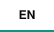
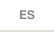

<!--
  GENERATED FILE — DO NOT EDIT.
  Rendered from profile/data/content.json + the GitHub API by
  profile-generator. Last generated: 2026-11-13
-->

<a href="https://github.com/didactika/.github/blob/main/profile/projects/npm-unpublished.md"><picture><source media="(prefers-color-scheme: dark)" srcset="https://raw.githubusercontent.com/didactika/.github/main/profile/assets/tab-en-on-dark.svg"></picture></a><a href="https://github.com/didactika/.github/blob/main/profile/projects/npm-unpublished.es.md"><picture><source media="(prefers-color-scheme: dark)" srcset="https://raw.githubusercontent.com/didactika/.github/main/profile/assets/tab-es-off-dark.svg"></picture></a>

# NPM packages · Unpublished packages

Not on npm yet. They can be used from their repository.

<b>1 package</b>

---

## Find a package

| Package | What it does | Latest | Maintained | Install |
|:--|:--|:-:|:-:|:--|
| <a href="#didactikamoodle-client-schemas"><b>@didactika/moodle-client-schemas</b></a> | Extracts strict, typed JSON Schemas and parameter contracts of the Moodle web services, for every version of… | — | — | — |

---

## Details

### @didactika/moodle-client-schemas

  

Extracts strict, typed JSON Schemas and parameter contracts of the Moodle web services, for every version of Moodle, with no running Moodle instance.

<a href="https://github.com/didactika/moodle-client-schemas">GitHub</a> · <a href="https://github.com/didactika/moodle-client-schemas/releases">Releases</a>

---

<a href="https://github.com/didactika/.github/blob/main/profile/projects/npm.md">← NPM packages</a>
